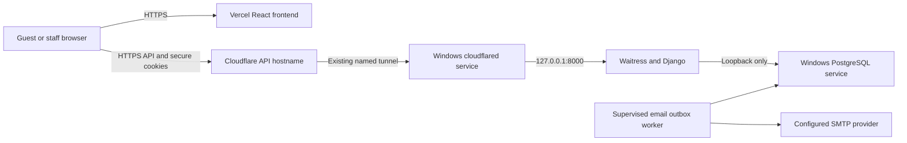

# Move Elparaiso from the laptop to an always-on Windows host

This guide preserves the existing system: React/Vite on **Vercel**, Django/Waitress and PostgreSQL on **Windows**, and the existing Cloudflare Tunnel at `api.elparaisohotelltd.com`. No ZIP, new application, DNS change or payment activation is required by this guide. Commands that install services, restore data or change the live connector are operator actions; they have not been run by the audit.



The PC must remain powered on, awake and online. Closing your browser must not stop the API. Use automatic services, reliable internet and power, Windows security updates, encrypted backups and an external uptime alert. Do not expose PostgreSQL or port 8000 to the internet.

## 1. What moves, and what must be recreated

| Item | Transfer method |
| --- | --- |
| Frontend source | Existing GitHub repository; clone on Windows. |
| Backend source and migrations | Existing GitHub repository; clone on Windows. |
| Python virtual environments | **Recreate on Windows** from `requirements.lock`; never copy Linux `.venv` or `venv`. |
| `node_modules`, `dist`, `staticfiles` | Rebuild; do not copy as the source of truth. |
| PostgreSQL data | Portable `pg_dump --format=custom` and `pg_restore`; never copy a running PostgreSQL data directory. |
| Hotel media and private gallery | Copy the actual configured storage roots separately, preserving directory structure. If gallery is already in private S3 storage, retain that configuration instead of switching storage during the move. |
| Real backend `.env`, SMTP and tunnel credentials | Transfer privately through a password manager or encrypted drive. Do not commit them. |
| Existing `DJANGO_SECRET_KEY` | **Preserve it** when moving the current database so sessions and signed links are not silently invalidated. Generate a new key only for a new installation. |

The new environment templates intentionally contain no usable passwords. The backend ignore rules now exclude Windows `venv`, secrets, dumps and local service binaries/logs.

## 2. Prepare the source repositories on the laptop

Review the audit changes in both repositories. Commit only reviewed source/configuration/documentation changes, then push when you intend to release. The Vercel Git integration may automatically deploy a frontend push, so do not push an unfinished release.

Repositories already configured by this project:

- Frontend: `https://github.com/MBURU-ERICK/elparaiso-hotel.git`
- Backend: `https://github.com/MBURU-ERICK/backend-elpa.git`

Record the commit SHA from **each** repository with `git rev-parse HEAD`. Transfer source through authenticated Git rather than copying hidden files and installed dependencies. Do not put credentials in Git remote URLs. Keep repositories private if that is your intended access policy.

## 3. Install Windows prerequisites

Use a supported, patched Windows installation and install:

- Git for Windows, including Git Credential Manager.
- **Node.js 24 LTS**. The project accepts supported Node 22.13+ in the 22 line or Node 24; the release was checked with Node 24. Node 20 on the laptop is not the recommended production/deployment runtime.
- Latest patched **Python 3.13, 64-bit**, preferably installed for all users so the service account can run it.
- PostgreSQL **17**, latest patch in that major version, with command-line tools. Confirm the source server version before choosing a target; do not restore a newer-major dump into an older server.
- Current `cloudflared` from Cloudflare's official distribution.
- A reviewed WinSW release from its official GitHub releases if using the supplied Windows service template.

Create this layout:

```text
C:\Elparaiso\elparaiso-hotel       frontend Git checkout
C:\Elparaiso\backend              backend Git checkout
C:\Elparaiso\data\media           persistent hotel images
C:\Elparaiso\data\private-gallery persistent private gallery
C:\Elparaiso\backups              private backups; also keep an encrypted off-PC copy
```

From PowerShell:

```powershell
New-Item -ItemType Directory -Force C:\Elparaiso | Out-Null
Set-Location C:\Elparaiso
git clone https://github.com/MBURU-ERICK/elparaiso-hotel.git elparaiso-hotel
git clone https://github.com/MBURU-ERICK/backend-elpa.git backend
node --version
py -3.13 --version
Get-Service *postgres*
```

Authenticate using Git Credential Manager when prompted. Check out the recorded release SHAs for a reproducible move. Do not clone with an access token embedded in the URL.

## 4. Recreate environments and configure private settings

Frontend:

```powershell
Set-Location C:\Elparaiso\elparaiso-hotel
if (-not (Test-Path .env.local)) { Copy-Item .env.example .env.local }
# In .env.local keep VITE_API_URL=https://api.elparaisohotelltd.com
npm.cmd ci
```

Use `npm.cmd` in PowerShell to avoid depending on the npm PowerShell shim's execution policy. Production builds now reject a missing, localhost, non-HTTPS or malformed API origin instead of silently shipping a localhost API.

Backend:

```powershell
Set-Location C:\Elparaiso\backend
py -3.13 -m venv venv
.\venv\Scripts\python.exe -m pip install -r requirements.lock
.\venv\Scripts\python.exe -m pip check
if (-not (Test-Path .env)) { Copy-Item .env.example .env }
```

Edit `.env` privately. Copy the existing production Django secret, SMTP identity and other current provider settings through a secure channel. Fill the new local database password. Do not replace working secrets with the empty template values.

Keep these public settings consistent:

```dotenv
DJANGO_DEBUG=False
ALLOWED_HOSTS=api.elparaisohotelltd.com,127.0.0.1,localhost
CORS_ALLOWED_ORIGINS=https://elparaisohotelltd.com,https://www.elparaisohotelltd.com
CSRF_TRUSTED_ORIGINS=https://elparaisohotelltd.com,https://www.elparaisohotelltd.com,https://api.elparaisohotelltd.com
CUSTOMER_FRONTEND_URL=https://elparaisohotelltd.com
DB_HOST=127.0.0.1
DB_PORT=5432
DB_SSLMODE=disable
CACHE_LOCATION=elparaiso_cache
MEDIA_ROOT=C:/Elparaiso/data/media
GALLERY_LOCAL_ROOT=C:/Elparaiso/data/private-gallery
SESSION_COOKIE_SAMESITE=Lax
TRUST_PROXY_SSL_HEADER=True
```

`DB_SSLMODE=disable` is only for the loopback-only database on the same computer. Remote databases need authenticated/encrypted transport appropriate to the provider. Proxy trust is only safe with the supplied loopback-only Waitress/proxy setup; do not bind it publicly. For an existing S3 gallery, preserve the bucket, endpoint, region and private credentials rather than replacing them with local gallery configuration.

The public frontend and API use the same parent domain, supporting secure same-site cookies. Both frontend host variants remain allowed while the canonical-host transition is pending. No website-domain redirect should be duplicated in `vercel.json` against an opposing Vercel Domains rule.

## 5. Create an empty rehearsal database

In PostgreSQL's SQL Shell (`psql`), connect as the installation administrator and create a dedicated non-superuser app login. Choose a strong password when `\password` prompts; do not write it into a command or Git:

```sql
CREATE ROLE elparaiso_app LOGIN NOSUPERUSER NOCREATEDB NOCREATEROLE;
\password elparaiso_app
CREATE DATABASE elparaiso_rehearsal OWNER elparaiso_app;
```

Initially use `DB_NAME=elparaiso_rehearsal` in the Windows `.env`. Keep PostgreSQL listening on loopback and leave port 5432 closed to other machines. The hotel database requires PostgreSQL's `btree_gist` extension and exclusion constraints; do not substitute SQLite. Use matching PostgreSQL client/server major versions for the migration where possible.

## 6. Rehearse a data transfer before the real cutover

On the laptop, produce a PostgreSQL custom-format dump using the actual source database/host/user from the private configuration. The example prompts for the database password and does not embed it:

```bash
umask 077
transfer_dir="$HOME/Elparaiso-transfer-rehearsal-$(date +%Y%m%d-%H%M%S)"
mkdir "$transfer_dir"
read -r -p "Source database name: " transfer_dbname
read -r -p "Source database user: " transfer_dbuser
pg_dump --host=127.0.0.1 --port=5432 --username="$transfer_dbuser" --dbname="$transfer_dbname" --password --format=custom --no-owner --no-privileges --file="$transfer_dir/hotel.dump"
```

Substitute the actual host/port if different. Stop on any dump error. Copy the **actual** `MEDIA_ROOT` and `GALLERY_LOCAL_ROOT` into `media` and `private-gallery` subdirectories of the transfer folder. The default source paths are `~/Projects/backend/media` and `~/Projects/backend/private-gallery`; confirm them against your configuration before copying. Do not make private gallery files public.

For the default source storage paths, the copy commands are:

```bash
cp -a "$HOME/Projects/backend/media" "$transfer_dir/media"
cp -a "$HOME/Projects/backend/private-gallery" "$transfer_dir/private-gallery"
```

Use the actual configured paths if different; do not copy a local gallery folder as a replacement for an existing S3 gallery. Create a portable checksum manifest after copying:

```bash
python3 ~/Projects/elparaiso-hotel/scripts/transfer-integrity.py "$transfer_dir" --write
```

Move that whole folder on an encrypted drive or through another private transfer channel. Database dumps contain guest/contact/business data. The manifest detects missing, extra or changed bytes; it does not encrypt or authenticate the transfer.

On Windows, replace `E:\Elparaiso-transfer-rehearsal` below with the actual transfer folder:

```powershell
py -3.13 C:\Elparaiso\elparaiso-hotel\scripts\transfer-integrity.py E:\Elparaiso-transfer-rehearsal
```

Only restore if verification passes. Use PostgreSQL's installed `bin` directory if `pg_restore.exe` is not on PATH:

```powershell
pg_restore.exe --host=127.0.0.1 --port=5432 --username=elparaiso_app --password --dbname=elparaiso_rehearsal --no-owner --no-privileges --single-transaction --exit-on-error E:\Elparaiso-transfer-rehearsal\hotel.dump
```

Restore into an empty database. Do not add `--clean` to overwrite an existing live database. Keep any source storage paths intact relative to their roots when placing photographs under `C:\Elparaiso\data`. `Copy-Item` is sufficient for a small controlled transfer; if using `robocopy`, note that successful copy exit codes may be 0–7. Never use `/MIR` against an existing production data directory without a separate reviewed plan.

In `C:\Elparaiso\backend`, using the **rehearsal** `.env`:

```powershell
.\venv\Scripts\python.exe manage.py check --deploy --fail-level WARNING
.\venv\Scripts\python.exe manage.py audit_booking_integrity --pre-migration
.\venv\Scripts\python.exe manage.py migrate --plan
# Review migration plan and resolve reported conflicts before proceeding.
.\venv\Scripts\python.exe manage.py migrate --noinput
.\venv\Scripts\python.exe manage.py createcachetable
.\venv\Scripts\python.exe manage.py collectstatic --noinput
.\venv\Scripts\python.exe manage.py audit_booking_integrity
```

The pre-migration audit supports the schema described in the existing `docs/PRODUCTION_READINESS_AUDIT.md`; follow that document if starting from an older schema. Do not delete conflicting bookings just to make a constraint migration pass.

For rehearsal, start **Waitress alone**, not the supervisor/email worker, so copied pending production emails are not sent:

```powershell
.\venv\Scripts\python.exe -m waitress --listen=127.0.0.1:8000 --trusted-proxy=127.0.0.1 --trusted-proxy-headers=x-forwarded-proto config.wsgi:application
```

Do not attach this rehearsal database to the production tunnel. For a local HTTPS-aware readiness probe from a separate console:

```powershell
Invoke-RestMethod http://127.0.0.1:8000/api/ready/ -Headers @{ Host = "api.elparaisohotelltd.com"; "X-Forwarded-Proto" = "https" }
```

Expect `status: ready`. The header is appropriate only for this trusted loopback probe. Direct HTTP browser navigation may redirect to HTTPS because production settings correctly require HTTPS. Use a separate authorized staging hostname with matching CORS/CSRF settings for a complete browser rehearsal. Stop this foreground Waitress before installing/starting the supervised service.

Do not run the full database test suite against the restored operational database. CI and the audit use an isolated PostgreSQL test database, test email transport and test media roots.

## 7. Prepare the supervised Windows backend

The existing `deploy/start-backend.ps1` checks deployment settings and applied migrations, then starts Waitress plus **one** continuous email worker. If either exits, the wrapper stops the other and returns failure for the Windows service manager to restart the group.

Do not also schedule `send-notifications.ps1` or run another manual `--watch` process. Avoid sending copied pending emails during rehearsal. Install the supervisor for final operation only when the final database/settings are ready.

For the supplied WinSW configuration:

1. Download a reviewed WinSW executable from its official release page and verify it. Rename it to `ElparaisoBackend.exe` beside `C:\Elparaiso\backend\deploy\windows\ElparaisoBackend.xml`. The binary is intentionally not committed.
2. Read the XML before installation. It runs as **LocalService**, not administrator, restarts on failure and retains rotated logs. It locates the existing startup script relative to itself.
3. Grant LocalService read/execute access to the checkout and Python installation, read-only access to `.env`, and modify access to persistent media/private-gallery and service logs. Keep `.env`, backups and tunnel credentials private. The PostgreSQL service has its own separate data-directory ACL.

Example ACL preparation from an administrator PowerShell, after reviewing the paths:

```powershell
New-Item -ItemType Directory -Force C:\Elparaiso\data\media,C:\Elparaiso\data\private-gallery,C:\Elparaiso\backend\deploy\windows\logs | Out-Null
icacls C:\Elparaiso\backend /grant '*S-1-5-19:(OI)(CI)RX'
icacls C:\Elparaiso\data /grant '*S-1-5-19:(OI)(CI)M'
icacls C:\Elparaiso\backend\deploy\windows\logs /grant '*S-1-5-19:(OI)(CI)M'
```

SID `S-1-5-19` is LocalService. Through the `.env` file's Advanced Security UI, disable inherited broad user access and retain only the deployment operator/Administrators and LocalService read access. Never grant Everyone access to fix a permissions error. Make the backup folder accessible only to the backup/operator accounts; the web service does not need it.

After final data/settings are ready, an administrator can install/start:

```powershell
Set-Location C:\Elparaiso\backend\deploy\windows
.\ElparaisoBackend.exe install
.\ElparaisoBackend.exe start
.\ElparaisoBackend.exe status
Get-Service ElparaisoBackend
```

No terminal must remain open. Review `deploy\windows\logs`, readiness and Windows Event Viewer. Confirm PostgreSQL's service starts automatically and a reboot brings the API/worker back. The restart policy retries a backend start if the database is not ready yet. Do not work around errors by enabling DEBUG or weakening deployment checks.

## 8. Controlled final cutover: one database writer

**Do not connect both the laptop and Windows backend to the same production Cloudflare Tunnel while they use different databases.** Cloudflare may distribute requests across connectors, creating divergent bookings and email queues.

Schedule a short maintenance window:

1. Keep the current source database/server and verified backups available for rollback.
2. Stop incoming booking/staff writes on the laptop; stop its web service and its email dispatcher, then stop its old tunnel connector. Use the actual existing service names, not guessed process kills. Keep PostgreSQL running long enough to dump it.
3. Take a **new final** database dump and storage copy after writers are stopped. Create and verify a new transfer manifest. Do not use the older rehearsal copy as the final database.
4. On Windows create a fresh final database `elparaiso`, owned by `elparaiso_app`; restore the final dump with the same checked command, changing `--dbname` to `elparaiso`.
5. Change the private Windows `.env` to `DB_NAME=elparaiso`. Place the final storage files, run the migration/audit/static/cache checks, and verify counts, recent booking references and photo coverage against the source. Do not copy rehearsal test bookings into the final database.
6. Start `ElparaisoBackend`. It now resumes the transferred email outbox. Validate its local readiness before opening the public path.
7. In Cloudflare Zero Trust, use the **existing named tunnel** and its Windows connector installation instructions. Install `cloudflared` as an automatic Windows service with the actual private tunnel token/configuration. Keep the public route `api.elparaisohotelltd.com` → `http://127.0.0.1:8000`. Do not use a temporary `trycloudflare.com` URL. Do not paste tokens into Git, documentation or screenshots.
8. Start the Windows connector only after the old writer/connector is stopped and final restore is complete. Confirm the tunnel is Healthy and the public API is ready.

The audit observed **Cloudflare error 1033** from the live API. This indicates a connector/tunnel availability problem and cannot be fixed merely by building React. Public readiness must be checked again after the Windows connector is running.

## 9. Deploy the frontend from Windows to the existing Vercel project

From `C:\Elparaiso\elparaiso-hotel`:

```powershell
powershell.exe -NoProfile -ExecutionPolicy RemoteSigned -File .\deploy\windows\Test-WindowsRelease.ps1 -BackendPath C:\Elparaiso\backend
```

The script runs frontend lint/tests/build/SEO checks and backend dependency/deployment/migration checks. It does **not** apply migrations, install/start services, send mail or publish anything. Files should be reviewed local Git checkouts; do not globally disable PowerShell execution policy.

Use the existing Vercel project, not a new application:

- Git repository: this frontend repository.
- Node runtime: 24.x.
- Build command: `npm run build`.
- Output directory: `dist`.
- Public build environment: `VITE_API_URL=https://api.elparaisohotelltd.com`.
- Preserve genuine Google/Bing verification values if configured. Never add backend `.env`, SMTP credentials or DB passwords to Vercel frontend variables.

Trigger the approved release through the project's existing Git integration or Vercel dashboard. The Windows PC does not run `npm run dev` for visitors. Vercel serves the compiled frontend even when the browser on Windows is closed.

Manage www/non-www redirects in the hosting domain settings, not opposing application rules. Current code intentionally removed the rule that caused the stylesheet/JavaScript redirect loop. The desired canonical remains `https://elparaisohotelltd.com`; coordinate any host migration so assets and pages have one consistent redirect direction. See `TECHNICAL-SEO.md`.

## 10. Production acceptance, backups and rollback

From an outside connection, verify:

```powershell
Invoke-RestMethod https://api.elparaisohotelltd.com/api/health/
Invoke-RestMethod https://api.elparaisohotelltd.com/api/ready/
Set-Location C:\Elparaiso\elparaiso-hotel
npm.cmd run check:seo:live
```

`check:seo:live` also checks emitted CSS/JavaScript status and MIME types. It can still flag the canonical hostname until the hosting redirect has been coordinated; do not ignore asset redirect failures.

Complete these live checks with the hotel team:

- Open homepage/rooms/private stays/booking/contact/gallery on a phone and desktop; no missing CSS, image URLs or loading failures.
- Staff login and CSRF-protected actions work from the actual frontend origin, with facility permissions preserved.
- Submit one agreed controlled booking, see it once in staff operations, and receive both intended guest/team emails. Availability, quote and acknowledgement must come from the real API.
- Confirm cancelled/conflicting bookings behave correctly without modifying financial/M-Pesa/accounting behavior.
- Upload a permitted test photo and confirm it survives a service restart; private images remain private.
- Reboot Windows, close the user session, and verify PostgreSQL, backend/worker and tunnel recover automatically.
- Inspect the outbox for exhausted messages and verify actual SMTP receipt; an API 200 alone does not prove email delivery.

Schedule database **and storage** backups using a dedicated account and protected PostgreSQL password file/secret store, never passwords in command arguments. Keep encrypted off-machine copies. Periodically restore into a separate database and check media integrity. Do not assume `pg_dump` also backs up uploaded files, PostgreSQL roles or tunnel credentials.

Before any future update: back up data, stop the service for schema changes, review `migrate --plan`, apply reviewed migrations, collect static files, restart and probe readiness. Do not migrate automatically inside the Windows service startup.

If rollback is needed **before Windows accepts any new writes**, stop its services/connector and return to the verified source setup. If Windows has accepted new bookings or sent emails, do not simply reactivate the stale laptop database: first preserve and reconcile/back-transfer the new data under a reviewed plan. Keep a single active writer throughout.

## References

- Django deployment checklist: https://docs.djangoproject.com/en/5.2/howto/deployment/checklist/
- Cloudflare Windows service: https://developers.cloudflare.com/tunnel/features/locally-managed-tunnels/as-a-service/windows/
- WinSW service configuration: https://github.com/winsw/winsw/blob/v3/docs/xml-config-file.md
- Waitress proxy configuration: https://docs.pylonsproject.org/projects/waitress/en/stable/arguments.html
- PostgreSQL portable dumps: https://www.postgresql.org/docs/current/app-pgdump.html
